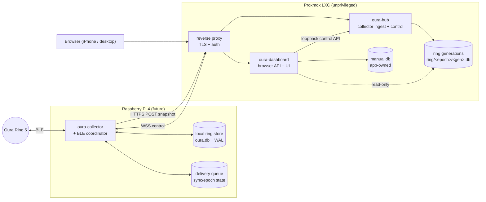

# ARCHITECTURE

Proposed smallest useful architecture. Status: **proposal**, pending review.
Nothing here is hardware-verified.

## Topology



## Processes (explicit responsibilities)

| Process | Where | Owns | Listens on |
|---|---|---|---|
| `oura-collector` | Pi 4 | BLE, ring auth key, local ring store, snapshot creation, delivery queue, command execution | outbound only |
| `oura-hub` | LXC | collector registry, snapshot validation/activation, generation store, command queue, control WebSocket, audit log | loopback (behind proxy) |
| `oura-dashboard` | LXC | browser UI + JSON API, manual metrics, charts, ops panel | loopback (behind proxy) |
| `oura-backup.timer` | LXC | consistent backup of `manual.db` + active ring generation | — |
| reverse proxy | LXC | TLS termination, browser authentication, single LAN entry point | LAN / VPN only |

Alternative considered and rejected for MVP: one binary with two listeners
(fewer processes, but mixes the collector trust domain with the browser trust
domain in one address space). Revisit only with a documented reason.

`oura-dashboard` opens the ring generation **read-only** (upstream
`oura-store` already supports a read-only open that does not change schema or
journal mode) so activation can never swap a database beneath a reader.

## Crate layout in the fork

| Crate | Origin | Purpose |
|---|---|---|
| `crates/oura-cli` | upstream (extended) | CLI + dashboard server; new routes bolted onto the existing dispatcher |
| `crates/oura-summary` | upstream | summary/metric layer (kept as-is) |
| `crates/oura-core` | upstream | shared core (kept, iOS FFI unused) |
| `crates/oura-manual` | **new** | manual + imported metric store (`manual.db`), units, dated semantics |
| `crates/oura-import` | **new** | import framework: dry run, mapping, provenance, rollback |
| `crates/oura-protocol-v1` | **new** | versioned upload + control message types shared by hub/collector/simulator |
| `crates/oura-hub` | **new** | ingestion, generations, continuity, control queue, ops API |
| `crates/oura-collector` | **new** | Pi-side service; BLE behind a trait, scheduler, snapshot, delivery, WS client |
| `crates/oura-collector-sim` | **new** | simulator: same contracts, no BLE, deterministic scenarios |

`oura-dna` and `oura-ffi` are not built for this deployment (iOS not required).
The DNA and blood panels are removed from the served asset set: `/api/dna/fetch`
performs an outbound download from a third-party FTP endpoint, and the DNA page
links out to `pgscatalog.org`. Requirement: disable unrelated outbound
integrations. See `DECISIONS/0006-disable-dna-blood-panels.md` (to be written).

## Storage ownership

| Store | Owner | Replaceable by ring ingestion? |
|---|---|---|
| `ring/<epoch>/<gen>.db` | `oura-hub` | yes — that is the point |
| active-generation pointer + checksums + audit | `oura-hub` (`hub.db` or JSON state) | no |
| `manual.db` | `oura-manual` via `oura-dashboard` | **never** |
| `profile.json` | upstream `oura-summary` | no (not ring data) |
| Pi local ring store | `oura-collector` | n/a |
| ring auth key | `oura-collector` only | n/a |

## Interfaces (v1, frozen before parallel work)

All messages carry `protocol_version: 1`. Field names are stable; additions are
new optional fields, never renames.

### Upload — `POST /api/v1/collector/snapshot`

Body: `multipart/form-data`-free design — a single NDJSON/trailer-free binary
upload is avoided; use two parts:
`metadata` (JSON, small) + `snapshot` (the SQLite file bytes).

```json
{
  "protocol_version": 1,
  "schema_version": 2,
  "collector_id": "pi-01",
  "collector_epoch": "2026-11-07T09:00:00Z/1",
  "generation": 42,
  "created_unix": 1794046800,
  "size_bytes": 7340032,
  "sha256": "<hex>",
  "build_revision": "<git rev>",
  "identity": "production"
}
```

Server order of operations: authenticate → enforce size/time limits → write to a
restricted staging path → verify size and SHA-256 → verify it is a SQLite
database with expected tables/`schema_version` → reject older/stale generations →
activate as a generation → retain prior known-good generation → acknowledge.
Acknowledge only after durable acceptance. Duplicate delivery of an already
accepted generation is a no-op success.

### Control — `WSS /api/v1/collector/control`

Pi-initiated, authenticated with a distinct collector credential. JSON frames:

```json
{"type":"hello","protocol_version":1,"collector_id":"pi-01","build_revision":"..."}
{"type":"command","id":"<ulid>","name":"sync_now","args":{},"created_unix":0,"expires_unix":0}
{"type":"receipt","id":"<ulid>","state":"accepted"|"rejected","reason":null}
{"type":"result","id":"<ulid>","state":"completed"|"failed"|"cancelled"|"expired","detail":{}}
{"type":"status","collector_state":{...}}
{"type":"stream","id":"<ulid>","kind":"live_hr","sample":{"bpm":62,"unix":0}}
```

Command names (allowlist, versioned): `sync_now`, `refresh_device_info`,
`refresh_battery`, `collector_status`, then `start_live_hr`, `stop_live_hr`,
`inspect_supported_features`, and explicitly permitted feature changes. Never
`factory_reset`, `dfu`, `flight_mode`, or any arbitrary shell.

### Browser API (new routes on the existing dispatcher)

| Method | Path | Purpose |
|---|---|---|
| GET/POST/PUT/DELETE | `/api/manual/entries` | dated calorie/weight CRUD |
| GET | `/api/manual/series` | chart series (calories, weight + rolling trend) |
| GET | `/api/manual/export` | full manual-data export (CSV/JSON) |
| GET | `/api/ops/status` | last collection, last accepted upload, newest measurement, pending delivery, last control contact, recent errors |
| POST | `/api/control/{name}` | queue an allowlisted command through the hub |
| GET | `/api/control/events` | command lifecycle + result stream (SSE) |

Existing upstream routes are kept except the DNA/blood ones.

## Network and security model

- Collector traffic: HTTPS with certificate verification against an operator
  CA; separate collector token/key rotation; size and rate limits.
- Browser traffic: HTTPS, authenticated session, secure cookies, CSRF (keep the
  existing `X-Oura-Dash` same-origin guard and Host check), Origin-checked
  WebSocket if ever needed.
- No public internet exposure by default. LAN/VPN only.
- Ring auth key stays on the Pi; never in git, examples, fixtures, logs, or
  agent handoffs.
- Build/install downloads (crates.io, apt, git deps) are distinct from runtime
  network use and are documented separately in `OPERATIONS.md`.

## Build and run without hardware

Docker (present on the dev machine) is the local equivalent of the LXC for
building, running, and testing the model-free dashboard. `scripts/docker-build-linux.sh`
records the exact toolchain and system packages. **Current constraint:** the
build requires Rust ≥ 1.85 (`clap_lex` 1.1.0 needs `edition2024`); Rust 1.83
fails (`scripts/`, `out/build.log`).
